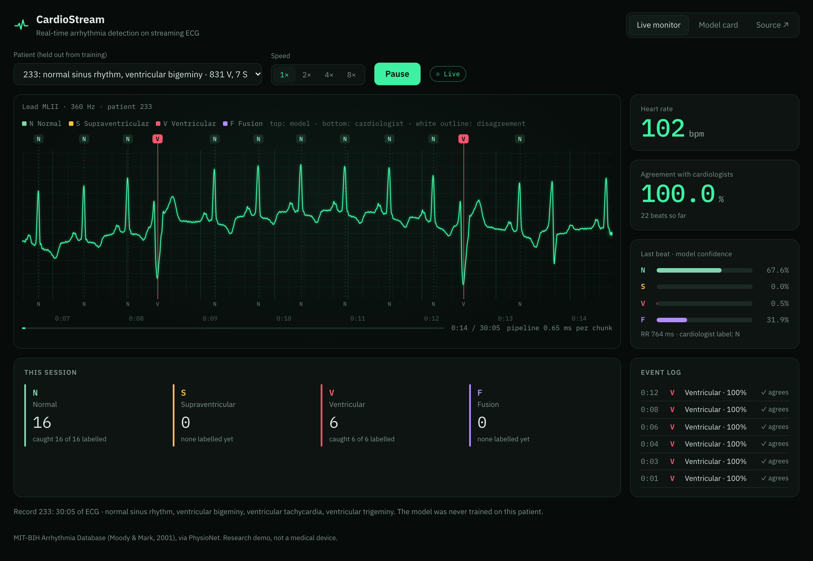
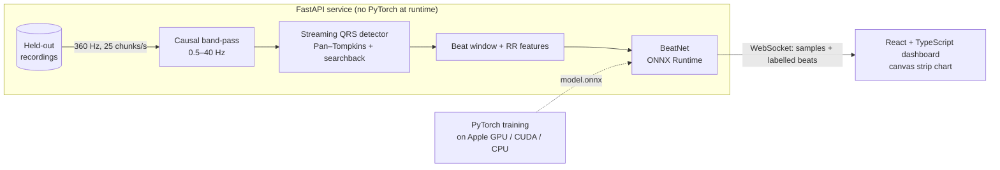

# CardioStream

**Real-time arrhythmia detection on streaming ECG, evaluated on patients the model has never seen.**

### ▶ [Live demo: cardiostream.onrender.com](https://cardiostream.onrender.com)
<sub>Free hosting sleeps when idle, so the first load can take up to a minute.</sub>

[](https://github.com/Mazennmetwallyy/cardiostream/actions/workflows/ci.yml)


[](https://render.com/deploy?repo=https://github.com/Mazennmetwallyy/cardiostream)

CardioStream replays real hospital ECG recordings at real-time speed. It finds every heartbeat as it arrives,
classifies it with a small neural network, and shows the result on a live, bedside-monitor-style dashboard
next to the label a cardiologist gave that beat.



## Why this project is different

Most MIT-BIH arrhythmia models report ~99% accuracy. Nearly all of them shuffle heartbeats from **the same
patients** into the training and test sets, so the model is tested on hearts it has already seen. A real
monitor never gets that luxury.

CardioStream uses the **inter-patient** protocol (de Chazal et al., 2004): it trains on 22 patients and is
tested once on 22 **different** patients. Every number below, and every recording on the dashboard, comes
from patients the model never saw.

## Results

Held-out test set: 22 patients, 49,712 heartbeats. These numbers come from the **full live pipeline**: the
streaming beat detector, then feature extraction, then the model, exactly as it runs on the dashboard.

| | |
|---|---|
| Beat detection sensitivity / precision | **99.71% / 99.71%** (± 150 ms, AAMI EC57 tolerance) |
| Beat classification accuracy | **94.2%** |
| Macro F1 (4 classes weighted equally) | 0.592 |
| Model inference | **0.13 ms per beat** on a laptop CPU (ONNX Runtime) |
| Model size | 77k parameters, 308 KB |

| Class | Precision | Recall | F1 | Test beats |
|---|---|---|---|---|
| N: normal / bundle branch block | 96.8% | 97.1% | 0.969 | 44,120 |
| S: supraventricular ectopic | 59.7% | 45.9% | 0.519 | 1,825 |
| **V: ventricular ectopic (PVC)** | 82.3% | **93.1%** | **0.873** | 3,190 |
| F: fusion | 0.8% | 0.5% | 0.006 | 386 |

Using the cardiologists' reference beat positions instead of the detector gives almost the same result
(94.3% accuracy, macro F1 0.593). So running in real time costs almost nothing.

**What these numbers say:**
- **Ventricular ectopic beats (PVCs)**, the clinically important class, are caught 93% of the time.
- **Supraventricular beats** are the hard case: they look like normal beats and differ mainly in timing.
- **Fusion beats** don't transfer across patients at all. 90% of the training examples come from a single
  patient (record 208), so the model can't learn what fusion looks like in general. I report this rather than
  hide it. Published inter-patient results also show S and F as the weak classes.

## How a mistake was caught, and fixed without cheating

The first model (v1) used inverse-√-frequency class weights, a common default for imbalanced data. An
end-to-end test on a held-out patient failed: the model labelled about a quarter of that patient's normal beats as
fusion. Across all test patients, v1 made about 1,000 false fusion calls (F precision 0.6%).

Re-tuning until the test score improves would quietly turn the test set into a training set. So the choice was
made with **patient-grouped 5-fold cross-validation on the training patients only**
([`cardiostream/cv.py`](cardiostream/cv.py)). Each fold holds out whole patients.

| Class-weight power | 0 (none) | 0.25 | 0.5 (v1) |
|---|---|---|---|
| CV macro F1 (training patients) | **0.437** | 0.428 | 0.420 |
| CV normal-beat F1 | **0.921** | 0.906 | 0.867 |

Cross-validation showed the same failure on training patients alone: stronger weighting means more normal
beats are mislabelled. Unweighted training won, and the test set was then used once:

| Test set (live pipeline) | v1 (√-weighted) | v2 (chosen by CV) |
|---|---|---|
| Accuracy | 91.3% | **94.2%** |
| Macro F1 | 0.554 | **0.592** |
| S F1 / V F1 | 0.424 / 0.827 | **0.519 / 0.873** |

The CV scores are lower than the test scores because each CV fold trains on only ~18 patients, and the
training group includes some very hard recordings (e.g. 207, with ventricular flutter). v1's full metrics are
kept in [`docs/v1_metrics.json`](docs/v1_metrics.json).

## Architecture



**Engineering decisions worth noting**

- **One code path for training and serving.** Filtering, beat centring and RR features live in
  [`cardiostream/signal.py`](cardiostream/signal.py), and both training and the live server call it. The filter
  is causal and stateful, so filtering a record in 14-sample chunks gives exactly the same output as filtering
  it in one go (tested). That removes train/serve skew.
- **A streaming QRS detector, not ground-truth beat positions.** It's a Pan–Tompkins-style detector with
  adaptive thresholds and a bounded 350 ms lookahead. Two fixes came from measurement: *searchback* for overdue
  beats raised sensitivity on record 228 from 59% to 97%, and an *absolute amplitude floor* (found by a unit
  test) stops a disconnected lead from producing phantom beats.
- **Model:** a residual 1D-CNN over a 0.71 s beat window, combined with five RR-interval features (premature
  beats are partly a timing problem). It trains in about 2 minutes on a laptop GPU.
- **Serving:** exported to ONNX, so the server image needs only NumPy, SciPy and ONNX Runtime, not PyTorch.
- **Honest evaluation:** inter-patient split, hyperparameters chosen by grouped CV, a fixed training schedule
  with final weights (no early stopping on test), and evaluation of the deployed pipeline, not just the model.

## Run it

**Docker (one command):**
```bash
docker build -t cardiostream . && docker run --rm -p 8000:8000 cardiostream
# open http://localhost:8000
```

**From source:**
```bash
make setup      # venv with training + dev deps, and frontend packages
make dev        # API on :8000, serving the trained model in artifacts/
make web        # dashboard on :5173 (in a second terminal)
```

**Reproduce the results from scratch:**
```bash
make data       # download MIT-BIH from PhysioNet (~90 MB)
make cv         # 15 patient-grouped CV runs to pick class weighting
make train      # train on DS1, evaluate once on DS2, write artifacts/model.onnx + metrics.json
make records    # bundle the DS2 recordings for the demo
make test       # 21 tests: signal processing, API, and end-to-end on a held-out patient
```

## Project layout

```
cardiostream/
  signal.py          filtering, streaming QRS detector, beat windows, RR features
  data.py            MIT-BIH loading, AAMI classes, inter-patient DS1/DS2 split
  model.py           BeatNet (residual 1D-CNN + RR features)
  cv.py              patient-grouped cross-validation on training patients
  train.py           training, test evaluation (model + full pipeline), ONNX export
  inference.py       ONNX Runtime classifier + online pipeline
  api.py             FastAPI: REST + WebSocket stream
frontend/            React + TypeScript + Vite dashboard
artifacts/           model.onnx, metrics.json, cv.json, held-out demo recordings
tests/               pytest suite (run in CI)
```

**API:** `GET /api/health`, `GET /api/records`, `GET /api/model` (metrics), `POST /api/classify`
(batch inference), `WS /api/stream?record=233&speed=1`. Interactive docs at `/docs`.

## Limitations

- **Research demo, not a medical device.** It is not validated for clinical use.
- Single lead (MLII); 44 recordings from one lab, recorded 1975–79. Performance on modern wearables is unknown.
- S beats are often missed (46% recall), and fusion beats are effectively undetected across patients.
- The detector is tuned for 360 Hz MIT-BIH-style signals.

**Next steps:** patient-adaptive calibration from the first minutes of a recording, synthetic minority-class
beats (building on my [ECG generative models project](https://github.com/Mazennmetwallyy/ecg-generative-models)),
and evaluation on the INCART and SVDB databases.

## Data and references

- Moody GB, Mark RG. *The impact of the MIT-BIH Arrhythmia Database.* IEEE Eng Med Biol, 2001.
- Goldberger AL et al. *PhysioBank, PhysioToolkit, and PhysioNet.* Circulation, 2000.
- de Chazal P, O'Dwyer M, Reilly RB. *Automatic classification of heartbeats using ECG morphology and heartbeat
  interval features.* IEEE Trans Biomed Eng, 2004.
- Pan J, Tompkins WJ. *A real-time QRS detection algorithm.* IEEE Trans Biomed Eng, 1985.

Code: MIT licence. ECG data: Open Data Commons Attribution License v1.0 (PhysioNet).
